# ambientCG: Wicker materials

**19 assets from [ambientCG](https://ambientcg.com), dedicated to the public domain under [CC0](https://docs.ambientcg.com/license/).** Use them in any game, free or paid, and change them however you like; no credit is needed.

PBR materials as 1K and 2K JPG maps (colour, normal GL and DX, roughness, AO, displacement), one folder per resolution. 642.3 MB in all.

This is a copy kept by [zuujis-cc0](https://github.com/zuujis-cc0) so game makers can take single files from GitHub. It is not made by or affiliated with ambientCG: the originals, often in more formats and higher resolutions, are on [ambientcg.com](https://ambientcg.com). If they help you, consider [supporting ambientCG](https://www.patreon.com/ambientCG).

Every file is listed in [MANIFEST.tsv](MANIFEST.tsv) with its size and SHA-256. More free assets: [the Zuujis collection](https://github.com/zuujis-cc0/free-game-assets#readme).

| | | | |
| :-: | :-: | :-: | :-: |
| <a href="Wicker001">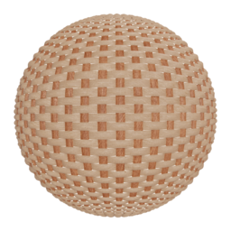</a> <b><a href="Wicker001">Wicker 001</a></b> by ambientCG · <a href="https://ambientcg.com/a/Wicker001">source</a> | <a href="Wicker002">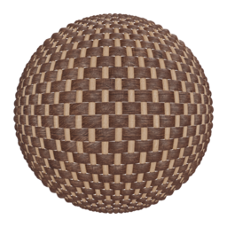</a> <b><a href="Wicker002">Wicker 002</a></b> by ambientCG · <a href="https://ambientcg.com/a/Wicker002">source</a> | <a href="Wicker003">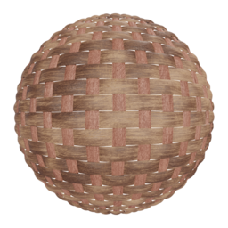</a> <b><a href="Wicker003">Wicker 003</a></b> by ambientCG · <a href="https://ambientcg.com/a/Wicker003">source</a> | <a href="Wicker004">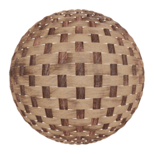</a> <b><a href="Wicker004">Wicker 004</a></b> by ambientCG · <a href="https://ambientcg.com/a/Wicker004">source</a> |
| <a href="Wicker005">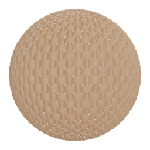</a> <b><a href="Wicker005">Wicker 005</a></b> by ambientCG · <a href="https://ambientcg.com/a/Wicker005">source</a> | <a href="Wicker006">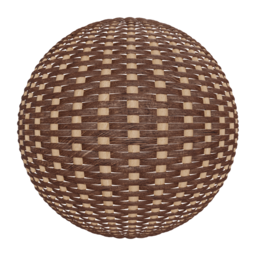</a> <b><a href="Wicker006">Wicker 006</a></b> by ambientCG · <a href="https://ambientcg.com/a/Wicker006">source</a> | <a href="Wicker007A">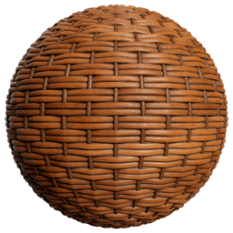</a> <b><a href="Wicker007A">Wicker 007 A</a></b> by ambientCG · <a href="https://ambientcg.com/a/Wicker007A">source</a> | <a href="Wicker007B">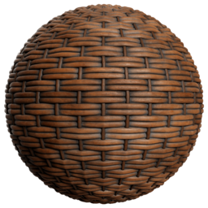</a> <b><a href="Wicker007B">Wicker 007 B</a></b> by ambientCG · <a href="https://ambientcg.com/a/Wicker007B">source</a> |
| <a href="Wicker008A">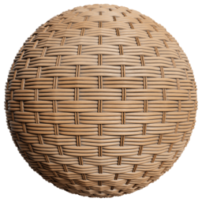</a> <b><a href="Wicker008A">Wicker 008 A</a></b> by ambientCG · <a href="https://ambientcg.com/a/Wicker008A">source</a> | <a href="Wicker008B">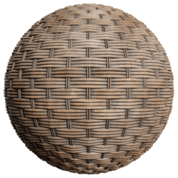</a> <b><a href="Wicker008B">Wicker 008 B</a></b> by ambientCG · <a href="https://ambientcg.com/a/Wicker008B">source</a> | <a href="Wicker009A">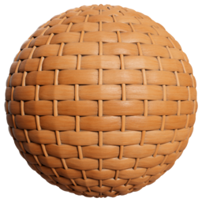</a> <b><a href="Wicker009A">Wicker 009 A</a></b> by ambientCG · <a href="https://ambientcg.com/a/Wicker009A">source</a> | <a href="Wicker009B">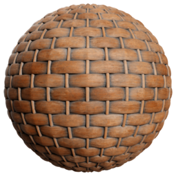</a> <b><a href="Wicker009B">Wicker 009 B</a></b> by ambientCG · <a href="https://ambientcg.com/a/Wicker009B">source</a> |
| <a href="Wicker010A">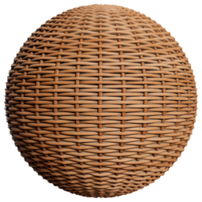</a> <b><a href="Wicker010A">Wicker 010 A</a></b> by ambientCG · <a href="https://ambientcg.com/a/Wicker010A">source</a> | <a href="Wicker010B">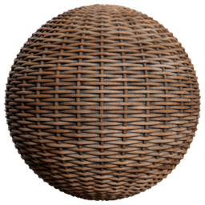</a> <b><a href="Wicker010B">Wicker 010 B</a></b> by ambientCG · <a href="https://ambientcg.com/a/Wicker010B">source</a> | <a href="Wicker011A">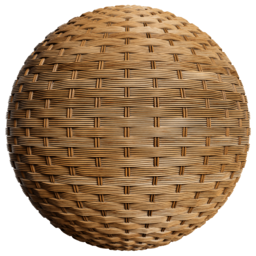</a> <b><a href="Wicker011A">Wicker 011 A</a></b> by ambientCG · <a href="https://ambientcg.com/a/Wicker011A">source</a> | <a href="Wicker011B">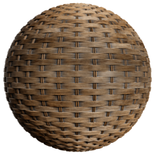</a> <b><a href="Wicker011B">Wicker 011 B</a></b> by ambientCG · <a href="https://ambientcg.com/a/Wicker011B">source</a> |
| <a href="Wicker012A">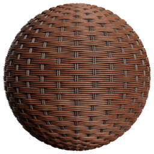</a> <b><a href="Wicker012A">Wicker 012 A</a></b> by ambientCG · <a href="https://ambientcg.com/a/Wicker012A">source</a> | <a href="Wicker012B">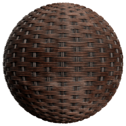</a> <b><a href="Wicker012B">Wicker 012 B</a></b> by ambientCG · <a href="https://ambientcg.com/a/Wicker012B">source</a> | <a href="Wicker013">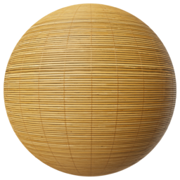</a> <b><a href="Wicker013">Wicker 013</a></b> by ambientCG · <a href="https://ambientcg.com/a/Wicker013">source</a> |  |

---

Kept up to date by this repository's own [update workflow](.github/workflows/update.yml), with code and plan from [cc0-mirror](https://github.com/zuujis-cc0/cc0-mirror). Something wrong? [Open an issue there](https://github.com/zuujis-cc0/cc0-mirror/issues/new) or use the [private report form](https://games.zuujis.com/report).
